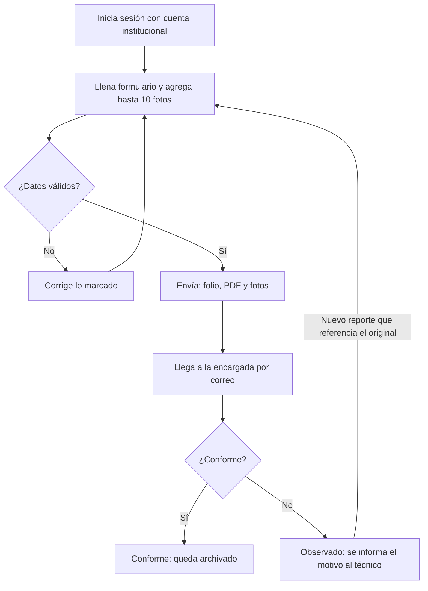
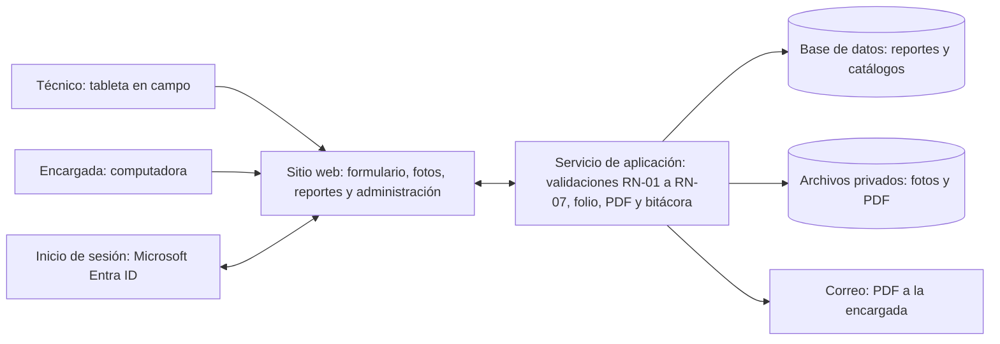

# Formularios-Demanda
Este repositorio es para almacenar los datos generados por los formularios de Ordenes de Maxima Demanda
# Levantamiento de requerimientos: Sistema web de mediciones indirectas

**Fecha:** 12 de octubre de 2026

## 1. Introducción

Objetivo. Reemplazar la hoja física "Órdenes de Máxima Demanda" por un sitio web interno donde el técnico registra cada orden de medición indirecta desde una tableta, y la encargada del proceso (Hazel) la recibe completa, bloqueada y con evidencia.

Este documento es la base acordada entre el área usuaria, TI y los tutores para desarrollar y probar el sistema. El formato del formulario ya está validado en el simulacro en HTML.

### 1.1 Alcance

| Incluye | No incluye |
| --- | --- |
| Órdenes de cambio, retiro, instalación nueva y reinstalación de medidor | Conexión con facturación o con la base de contratos |
| Medición indirecta en baja y media tensión, solo en Guanacaste | Medición directa (residencial sin transformadores) |
| Fotos de evidencia (máximo 10 por reporte) | Programación de cuadrillas u órdenes de trabajo |
| Comprobante PDF bloqueado, con el formato y logo de Coopeguanacaste, identificado por el número de orden y enviado por correo | Aplicación para instalar desde una tienda |
| Registro y verificación de reportes por la encargada |  |
| Mantenimiento de listas (bobinas, voltajes, cantones) sin programar |  |

### 1.2 Términos clave

| Término | Significado |
| --- | --- |
| Medición indirecta | El medidor no recibe la corriente directa de la línea, sino una señal reducida por transformadores de medida. La lectura se multiplica por la constante para obtener el consumo real. |
| TC (bobina) | Transformador de corriente. Se identifica por su relación, por ejemplo 600/5. |
| TP | Transformador de potencial, usado solo en media tensión. Relación única: 120:1. |
| Constante | Factor que convierte la lectura del medidor en consumo facturable. Si está mal, se cobra mal. |
| Medición macro | Medidor general de un grupo de medidores, típico de condominios. |
| Número de orden | Identificador de cada reporte. Da nombre al comprobante, al PDF y a las carpetas donde se guardan las fotos y el PDF. |

## 2. Situación actual y usuarios

### 2.1 Problemas de la hoja física

En una orden real de cambio de medidor (Nicoya, 02-09-2026) quedaron vacíos el número de orden, el contrato, los datos del medidor retirado, los sellos, las mediciones y las firmas. El cambio de constante solo quedó escrito a mano en observaciones.

| Problema | Consecuencia |
| --- | --- |
| Se pueden dejar campos vacíos | La encargada devuelve el reporte o se repite la visita |
| No hay campos para medición macro ni constante anterior | Datos críticos quedan en notas o se pierden |
| La hoja se puede alterar después | No sirve como evidencia ante un reclamo |
| No hay fotos | No se puede comprobar la instalación desde la oficina |
| La revisión contra la ficha es manual | Consume tiempo de la encargada |

### 2.2 Usuarios

| Rol | Quién | Puede |
| --- | --- | --- |
| Técnico | Inspectores y técnicos de mantenimiento | Llenar y enviar reportes desde la tableta. Ver sus envíos, sin editarlos. |
| Encargada | Hazel, dueña del proceso | Ver todos los reportes, marcarlos como Conforme u Observado y exportarlos. Es la única con acceso al contenido. |
| Administrador | TI | Gestionar usuarios y listas, consultar la bitácora. No ve el contenido de los reportes. |

### 2.3 Supuestos y restricciones

- Cada técnico tiene una tableta institucional con cámara y datos móviles.

- Todos los usuarios tienen cuenta institucional de Microsoft 365.

- El sistema no se conecta a la base de contratos: valida los datos entre sí.

- El tratamiento de datos de clientes debe cumplir la Ley 8968.

## 3. Proceso propuesto

El formulario valida mientras el técnico llena, así que solo llegan a la encargada reportes completos y coherentes.

*Flujo del reporte · 2 decisiones*

1. El técnico entra con su cuenta institucional; su nombre queda registrado.

2. Llena el formulario en el sitio del cliente. Si algo falta o no cuadra, lo corrige antes de irse.

3. Al enviar, el sistema asigna folio, fecha y hora, genera el PDF con el formato de Coopeguanacaste, lo guarda junto con las fotos en carpetas con el número de orden y bloquea el reporte.

4. La encargada recibe el PDF por correo y lo marca como Conforme u Observado.

5. Un reporte observado no se edita: el técnico envía uno nuevo que referencia el folio original.

## 4. Requerimientos funcionales

Prioridad: E = esencial para la primera versión · I = importante, primera mejora.

### 4.1 Formulario del técnico

El formulario sigue cuatro principios: tocar en lugar de escribir, no repetir etiquetas, calcular todo lo que se pueda y usar poco texto.

| ID | Requerimiento | Prioridad |
| --- | --- | --- |
| RF-01 | Entrar con la cuenta institucional; el nombre del técnico se llena solo | E |
| RF-02 | Orden y cliente: tipo de orden (botones), n.º de orden, contrato (opcional), cliente, cantón y distrito (listas de Guanacaste), señas (opcional) | E |
| RF-03 | Servicio: medición, sistema, conexión y voltaje como botones, filtrados según lo elegido antes; transformadores, kVA y medición macro (si es Sí, se pide la cantidad de medidores asociados) | E |
| RF-04 | Medidores: una sola tabla con columnas Retirado e Instalado (número, marca, clase, lecturas kWh y kW, sellos). La columna Retirado aparece solo en cambio o retiro | E |
| RF-05 | Transformadores y constante: bobina como botón; TP 120:1 fijo en media tensión; constante calculada automáticamente; constante anterior solo en cambio | E |
| RF-06 | Mediciones: tabla por fase con voltajes fase-neutro, entre fases y amperajes, mostrando el valor esperado; la fase 3 solo en trifásico | E |
| RF-07 | Fotos: un cuadro por tipo de foto, con la cámara de la tableta, máximo 10 en total. Tipos: bobinas, ficha técnica del TC, medidores con el sentido de corriente, conexión del transformador, voltajes del medidor; en cambio, además, lectura del medidor retirado y ficha del cambio | E |
| RF-08 | Cierre: observaciones y confirmación del técnico | E |
| RF-09 | Barra inferior con el conteo de datos pendientes; al tocarla lleva al primer campo con error | E |
| RF-10 | Guardar un borrador si se pierde la señal y enviarlo al recuperarla | I |

### 4.2 Envío y comprobante

| ID | Requerimiento | Prioridad |
| --- | --- | --- |
| RF-11 | No permitir el envío con datos faltantes o que no cuadran | E |
| RF-12 | Asignar folio consecutivo (MI-AAAA-0000) con fecha y hora del servidor | E |
| RF-13 | Generar un PDF no editable con el formato institucional de Coopeguanacaste: logo, encabezado de la cooperativa, secciones numeradas, líneas de firma y número de orden en el pie de cada página | E |
| RF-14 | Bloquear el reporte enviado; el técnico ve el comprobante pero no puede modificarlo | E |
| RF-15 | Enviar el PDF por correo a la encargada | E |
| RF-24 | Guardar las fotos y el PDF en carpetas nombradas con el número de orden (58213_Fotos y 58213_PDF), en lugar de una clave larga; cada foto se nombra con la orden y su tipo (58213_bobinas_1.jpg) | E |

### 4.3 Registro de la encargada

| ID | Requerimiento | Prioridad |
| --- | --- | --- |
| RF-16 | Listar, buscar y filtrar reportes por folio, orden, cliente, técnico, fecha, cantón y estado | E |
| RF-17 | Ver cada reporte con sus fotos, en solo lectura | E |
| RF-18 | Marcar como Conforme u Observado; si es Observado, con comentario que se le envía al técnico | E |
| RF-19 | Identificar cada reporte por su número de orden en el comprobante y en el registro | I |
| RF-20 | Exportar el listado a Excel | I |

### 4.4 Administración

| ID | Requerimiento | Prioridad |
| --- | --- | --- |
| RF-21 | Gestionar usuarios y roles | E |
| RF-22 | Actualizar listas y tolerancias (bobinas, voltajes, cantones) sin modificar el código | E |
| RF-23 | Bitácora inalterable de inicios de sesión, envíos, cambios de estado y descargas | E |

## 5. Reglas de validación

El tipo de medición define las opciones que ve el técnico. Toda regla se valida en la tableta y otra vez en el servidor.

### 5.1 Opciones según tipo de medición

| Dato | Baja tensión | Media tensión |
| --- | --- | --- |
| Transformadores | Solo TC | TC y TP |
| Bobinas de TC (/5) | 200, 300, 400, 600, 800, 1000, 2000 | 10, 20, 50, 100, 200 |
| TP | No aplica | 120:1 |
| Voltaje de servicio | Estrella-estrella: 120/208, 277/480 · Estrella-delta o monofásico: 120/240, 240/480 | 14 400/24 900 V |
| Constante | Bobina ÷ 5 × 102 % (600 → 122.4) | 120 × bobina (20 → 2400) |

### 5.2 Voltajes esperados en baja tensión (±0,5 %)

| Conexión y voltaje | F1-N | F2-N | F3-N | Entre fases |
| --- | --- | --- | --- | --- |
| Estrella-estrella 120/208 | 120 | 120 | 120 | 208 |
| Estrella-estrella 277/480 | 277 | 277 | 277 | 480 |
| Estrella-delta 120/240 | 120 | 120 | 216 | 240 |
| Estrella-delta 240/480 | 240 | 240 | 416 | 480 |
| Monofásico 120/240 | 120 | 120 | — | 240 |
| Monofásico 240/480 | 240 | 240 | — | 480 |

### 5.3 Reglas

| ID | Regla |
| --- | --- |
| RN-01 | Solo se muestran las bobinas, voltajes y TP válidos para la medición, sistema y conexión elegidos |
| RN-02 | La constante debe quedar dentro de ±0,5 % del valor calculado |
| RN-03 | En baja tensión, cada voltaje medido debe quedar dentro de ±0,5 % del esperado |
| RN-04 | Si en un cambio la constante nueva es distinta de la anterior, las observaciones son obligatorias |
| RN-05 | Al menos una foto por cada tipo que aplica; máximo 10 |
| RN-06 | El número de orden no se puede repetir |
| RN-07 | Un reporte enviado no se modifica; solo la encargada cambia su estado |

## 6. Requerimientos no funcionales

| ID | Tema | Requerimiento |
| --- | --- | --- |
| RNF-01 | Uso en tableta | Funciona en tabletas de 8 pulgadas o más; botones de al menos 44 px; también funciona en computadora |
| RNF-02 | Facilidad | Un técnico nuevo completa un reporte sin ayuda en la prueba piloto |
| RNF-03 | Velocidad | El formulario carga en menos de 3 s y el envío con 10 fotos tarda menos de 30 s, en 4G |
| RNF-04 | Seguridad | Conexión cifrada (HTTPS), acceso solo con cuenta institucional, fotos y PDF sin enlace público |
| RNF-05 | Integridad | Reportes enviados inalterables, identificados por número de orden, con bitácora sin opción de borrado |
| RNF-06 | Disponibilidad | 99 % entre las 6:00 y las 20:00, todos los días |
| RNF-07 | Respaldo | Copia diaria; datos, fotos y PDF se conservan 5 años |
| RNF-08 | Mantenimiento | Cambiar una lista o tolerancia no requiere programar |
| RNF-09 | Legal | Cumplimiento de la Ley 8968 de protección de datos personales |

## 7. Arquitectura y datos

El sitio se abre en el navegador de la tableta sin instalar nada. Un servicio en el servidor repite todas las validaciones antes de guardar, para que nadie pueda saltarlas.

*Arquitectura propuesta · 7 componentes*

La plataforma (por ejemplo, Power Apps con SharePoint o un sitio web propio) la define TI; estos requerimientos aplican a cualquiera de las dos.

### 7.1 Datos principales

| Entidad | Contiene |
| --- | --- |
| Usuario | Nombre, correo institucional, rol |
| Reporte | Folio, datos del formulario, fecha de envío, número de orden, estado (Enviado, Conforme u Observado) y folio original si es una corrección |
| Foto | Tipo de foto, archivo, fecha y hora; máximo 10 por reporte |
| Cambio de estado | Estado nuevo, comentario, quién y cuándo |
| Lista | Bobinas, voltajes, cantones, distritos y tolerancias |
| Bitácora | Usuario, acción, reporte, fecha y hora |

Los reportes no se borran ni se sobrescriben, y una lista que deja de usarse se desactiva en lugar de borrarse.

## 8. Criterios de aceptación

El sistema se acepta cuando estos casos pasan, primero en oficina y luego en un piloto de dos semanas con 2 o 3 técnicos en órdenes reales.

| ID | Prueba | Resultado esperado |
| --- | --- | --- |
| CA-01 | Enviar sin número de orden | Se bloquea y el campo se marca |
| CA-02 | Elegir baja tensión | Solo aparecen bobinas de 200 a 2000/5 y no aparece TP |
| CA-03 | Elegir media tensión | Solo aparecen bobinas de 10 a 200/5; TP y voltaje quedan fijos |
| CA-04 | Bobina 600 en baja tensión | La constante se llena con 122.4 |
| CA-05 | Estrella-delta 120/240 con F3-N en 120 V | Se bloquea: se esperan 216 V |
| CA-06 | Intentar agregar la foto 11 | No se agrega |
| CA-07 | Enviar un reporte válido | Se genera el PDF y se guardan las carpetas 58213_Fotos y 58213_PDF; el correo llega a la encargada en menos de 5 min |
| CA-08 | Un técnico intenta ver el reporte de otro | Acceso denegado y registrado en la bitácora |
| CA-09 | Revisar el PDF de la orden 58213 | Lleva el logo y el formato de Coopeguanacaste, y el número de orden en cada página |

Para medir la mejora se compara, antes y después del piloto: reportes con campos vacíos, reportes devueltos y visitas repetidas por datos faltantes.

## 9. Decisiones y conclusión

Este documento fue revisado con la encargada del proceso y los tutores, y cuenta con aprobación para pasar a desarrollo como versión 1.0.

### 9.1 Decisiones confirmadas

| Tema | Decisión |
| --- | --- |
| Dispositivo | Tableta institucional en campo |
| Tolerancia de la constante | ±0,5 % del valor calculado |
| Tolerancia de voltajes medidos (baja tensión) | ±0,5 % del valor esperado |
| Voltaje de media tensión | 14 400/24 900 V, única opción |
| TP | 120:1, única opción |
| Fotos | Máximo 10 por reporte, al menos una por tipo que aplica |
| Formato del formulario | El del simulacro aprobado |
| Identificador del reporte | Número de orden (reemplaza la huella digital) |
| Carpetas | 58213_Fotos y 58213_PDF, nombradas con el número de orden |
| Formato del PDF | Institucional de Coopeguanacaste, con logo |

### 9.2 Conclusión

El sistema web reemplaza una hoja física que permitía reportes incompletos, alterables y sin evidencia por un formulario en tableta que solo deja enviar reportes completos y coherentes. Las reglas técnicas del área (bobinas, voltajes por conexión y fórmulas de la constante) quedan dentro del formulario, por lo que el técnico no tiene que recordarlas y la revisión de la encargada pasa a ser solo una verificación secundaria.

Cada reporte queda bloqueado al enviarse, identificado por su número de orden, con fotos y un PDF con el formato de la cooperativa, y llega de forma exclusiva a la encargada. Con esto la cooperativa gana tres cosas: menos reportes devueltos y visitas repetidas, menos riesgo de errores de facturación por constantes mal registradas, y evidencia confiable ante cualquier reclamo o auditoría.

Con los requerimientos de este documento aprobados y el formato validado en el simulacro, el proyecto queda listo para su desarrollo.
