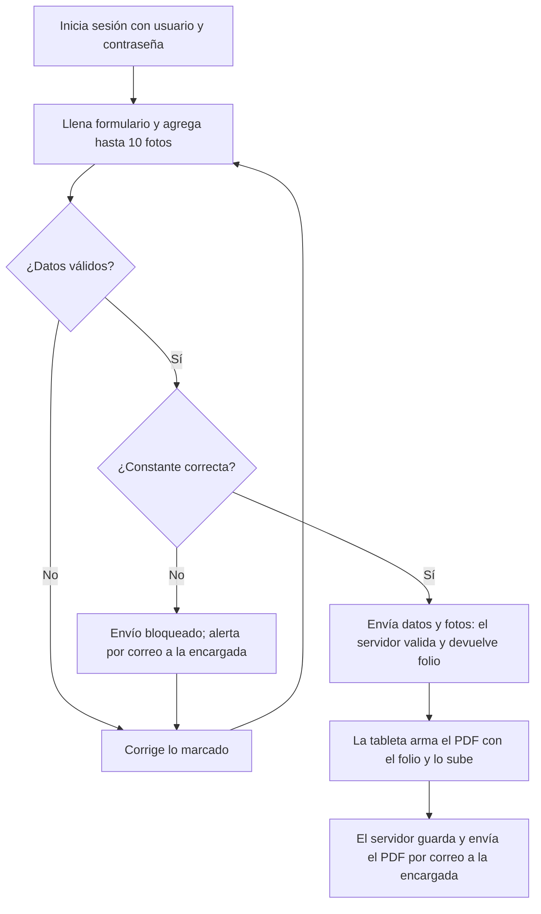
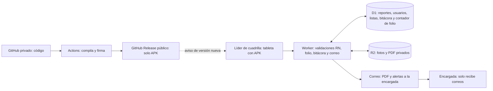

# Formularios-Demanda
Este repositorio es para almacenar los datos generados por los formularios de Ordenes de Maxima Demanda
# Levantamiento de requerimientos: Sistema de mediciones indirectas

**Versión:** 1.1 (borrador, pendiente de aprobación)

**Fecha:** 15 de octubre de 2026

### Control de versiones

| Versión | Fecha | Estado | Cambios |
| --- | --- | --- | --- |
| 1.0 | 12-oct-2026 | Aprobada | Versión inicial: sitio web, Microsoft 365, registro de la encargada en el sistema |
| 1.1 | 15-oct-2026 | Borrador | App Android (APK con Capacitor) en lugar de sitio web; plataforma Cloudflare (Worker, D1, R2) en lugar de Supabase; 2 líderes de cuadrilla con usuario y contraseña propios; registro y verificación de la encargada fuera del sistema (solo recibe correos); alerta de constante incorrecta (RF-25); distribución de la APK (RF-26); correo por Gmail SMTP con worker-mailer; "cantón" pasa a zona de concesión; tipo de cliente y acometida obligatorios; PDF generado en la tableta tras recibir el folio; bitácora con cadena de hashes; nuevo plan de respaldo; sección 9.3 de pendientes |

## 1. Introducción

Objetivo. Reemplazar la hoja física "Órdenes de Máxima Demanda" por una app Android interna donde el líder de cuadrilla registra cada orden de medición indirecta desde una tableta, y la encargada del proceso (Hazel) recibe por correo el reporte completo, bloqueado y con evidencia.

Este documento es la base acordada entre el área usuaria, TI y los tutores para desarrollar y probar el sistema. El formato del formulario ya está validado en el simulacro en HTML. La versión 1.1 es un borrador y necesita aprobación.

### 1.1 Alcance

| Incluye | No incluye |
| --- | --- |
| Órdenes de cambio, retiro, instalación nueva y reinstalación de medidor | Conexión con facturación o con la base de contratos |
| Medición indirecta en baja y media tensión, solo en Guanacaste | Medición directa (residencial sin transformadores) |
| Fotos de evidencia (máximo 10 por reporte) | Programación de cuadrillas u órdenes de trabajo |
| Comprobante PDF bloqueado, con el formato y logo de Coopeguanacaste, identificado por el número de orden y enviado por correo | Publicación en tiendas de aplicaciones (la APK se distribuye por GitHub Releases) |
| App Android (APK) con el formulario empaquetado, que abre sin señal | Registro y verificación de reportes por la encargada (Conforme/Observado, búsqueda y Excel): se llevan aparte, fuera del sistema |
| Alerta por correo a la encargada cuando la constante es incorrecta | |
| Mantenimiento de listas (bobinas, voltajes, zonas de concesión y distritos) sin programar | |

### 1.2 Términos clave

| Término | Significado |
| --- | --- |
| Medición indirecta | El medidor no recibe la corriente directa de la línea, sino una señal reducida por transformadores de medida. La lectura se multiplica por la constante para obtener el consumo real. |
| TC (bobina) | Transformador de corriente. Se identifica por su relación, por ejemplo 600/5. |
| TP | Transformador de potencial, usado solo en media tensión. Relación única: 120:1. |
| Constante | Factor que convierte la lectura del medidor en consumo facturable. Si está mal, se cobra mal. |
| Medición macro | Medidor general de un grupo de medidores, típico de condominios. |
| Número de orden | Identificador de cada reporte. Da nombre al comprobante, al PDF y a las carpetas donde se guardan las fotos y el PDF. |
| Zona de concesión | Área de servicio de la cooperativa. Reemplaza al "cantón" y agrupa distritos. |
| Folio | Número consecutivo (MI-AAAA-0000) que asigna el servidor al recibir un reporte válido. |
| Líder de cuadrilla | Persona que llena y envía los reportes desde la tableta. Es el usuario de la app. |
| Acometida | Tipo de conexión del cliente a la red: aérea o subterránea. |
| APK | Archivo de instalación de una app Android. Se instala directo, sin tienda. |
| Release | Versión publicada en GitHub con su APK firmada. |

## 2. Situación actual y usuarios

### 2.1 Problemas de la hoja física

En una orden real de cambio de medidor (Nicoya, 02-09-2026) quedaron vacíos el número de orden, el contrato, los datos del medidor retirado, los sellos, las mediciones y las firmas. El cambio de constante solo quedó escrito a mano en observaciones.

| Problema | Consecuencia |
| --- | --- |
| Se pueden dejar campos vacíos | La encargada devuelve el reporte o se repite la visita |
| No hay campos para medición macro ni constante anterior | Datos críticos quedan en notas o se pierden |
| La hoja se puede alterar después | No sirve como evidencia ante un reclamo |
| No hay fotos | No se puede comprobar la instalación desde la oficina |
| La revisión contra la ficha es manual | Consume tiempo de la encargada |

### 2.2 Usuarios

| Rol | Quién | Puede |
| --- | --- | --- |
| Líder de cuadrilla (×2) | Los dos líderes de cuadrilla | Llenar y enviar reportes desde la app. Ver sus propios envíos, sin editarlos. |
| Encargada | Hazel, dueña del proceso | No usa la app. Solo recibe correos: el PDF de cada reporte y las alertas de constante. Su registro y verificación se llevan fuera del sistema. |
| Administrador | Quien mantiene el sistema | Gestionar usuarios y listas en Cloudflare, consultar la bitácora y publicar versiones de la app. No ve el contenido de los reportes. **Pendiente:** definir quién ocupa este rol (ver 9.3). |

### 2.3 Supuestos y restricciones

- Cada líder de cuadrilla tiene una tableta institucional Android con cámara y datos móviles.

- Los usuarios entran con usuario y contraseña propios del sistema, no con cuenta de Microsoft.

- El sistema no se conecta a la base de contratos: valida los datos entre sí.

- La instalación de la APK fuera de tienda ya fue autorizada.

- El tratamiento de datos de clientes debe cumplir la Ley 8968.

- Todo corre en planes gratuitos: Cloudflare (Worker, D1, R2) y una cuenta de Gmail dedicada para enviar correos. El PDF adjunto pesa como máximo ~3,5 MB.

## 3. Proceso propuesto

El formulario valida mientras el líder llena, así que solo llegan a la encargada reportes completos y coherentes. Si la constante es incorrecta, el envío se bloquea y la encargada recibe una alerta.

*Flujo del reporte · 2 decisiones*

1. El líder entra con su usuario y contraseña; su nombre se llena solo y queda registrado.

2. Llena el formulario en el sitio del cliente, incluso sin señal (se guarda como borrador). Si algo falta o no cuadra, lo corrige antes de irse.

3. Si la constante queda fuera de ±0,5 % al intentar enviar, el envío se bloquea y se avisa de inmediato a la encargada por correo (RF-25). Sin señal, la alerta queda en cola.

4. Al enviar un reporte válido, el servidor valida de nuevo, asigna folio, fecha y hora, y guarda los datos y las fotos originales.

5. La tableta arma el PDF con el formato de Coopeguanacaste y el folio, y lo sube. El servidor guarda el PDF (con su SHA-256 en la bitácora) en carpetas con el número de orden, bloquea el reporte y envía el correo con el PDF adjunto a la encargada.

6. La revisión de la encargada (Conforme u Observado) se lleva fuera del sistema. Un reporte no se edita: si hay una corrección, el líder envía uno nuevo (ver pendiente sobre RN-06 en 9.3).

## 4. Requerimientos funcionales

Prioridad: E = esencial para la primera versión · I = importante, primera mejora.

### 4.1 Formulario del líder de cuadrilla

El formulario sigue cuatro principios: tocar en lugar de escribir, no repetir etiquetas, calcular todo lo que se pueda y usar poco texto.

| ID | Requerimiento | Prioridad |
| --- | --- | --- |
| RF-01 | Entrar con usuario y contraseña propios del sistema; el nombre del líder se llena solo | E |
| RF-02 | Orden y cliente: tipo de orden (botones), n.º de orden, contrato (obligatorio según el código actual; ver 9.3), cliente, zona de concesión y distrito (el distrito se filtra según la zona), señas (opcional) | E |
| RF-03 | Servicio: tipo de cliente (Residencial, Comercial o Industrial, obligatorio), acometida (Aérea o Subterránea, obligatoria), medición, sistema, conexión y voltaje como botones, filtrados según lo elegido antes; transformadores, kVA y medición macro (si es Sí, se pide la cantidad de medidores asociados) | E |
| RF-04 | Medidores: una sola tabla con columnas Retirado e Instalado (número, marca, clase, lecturas kWh y kW, sellos). La columna Retirado aparece solo en cambio o retiro (ver pendiente de retiro en 9.3) | E |
| RF-05 | Transformadores y constante: bobina como botón; TP 120:1 fijo en media tensión; constante calculada automáticamente; constante anterior solo en cambio | E |
| RF-06 | Mediciones: tabla por fase con voltajes fase-neutro, entre fases y amperajes, mostrando el valor esperado; la fase 3 solo en trifásico | E |
| RF-07 | Fotos: un cuadro por tipo de foto, con la cámara de la tableta, máximo 10 en total. Tipos: bobinas, ficha técnica del TC, medidores con el sentido de corriente, conexión del transformador, voltajes del medidor; en cambio, además, lectura del medidor retirado y ficha del cambio | E |
| RF-08 | Cierre: observaciones y confirmación del líder | E |
| RF-09 | Barra inferior con el conteo de datos pendientes; al tocarla lleva al primer campo con error | E |
| RF-10 | Con el formulario empaquetado en la app, abrirlo y llenarlo sin señal; guardar un borrador y enviarlo al recuperar la señal | I |

### 4.2 Envío y comprobante

El envío se hace en dos pasos: (1) datos y fotos, el servidor valida y devuelve el folio; (2) la tableta arma el PDF con el folio y lo sube.

| ID | Requerimiento | Prioridad |
| --- | --- | --- |
| RF-11 | No permitir el envío con datos faltantes o que no cuadran | E |
| RF-12 | Asignar folio consecutivo (MI-AAAA-0000) con fecha y hora del servidor, mediante un contador en la base de datos | E |
| RF-13 | Generar en la tableta, después de recibir el folio, un PDF no editable con el formato institucional de Coopeguanacaste: logo, encabezado de la cooperativa, secciones numeradas, líneas de firma y número de orden en el pie de cada página. Peso máximo ~3,5 MB. El servidor guarda además los datos y fotos originales y el SHA-256 del PDF en la bitácora | E |
| RF-14 | Bloquear el reporte enviado; el líder ve el comprobante pero no puede modificarlo | E |
| RF-15 | Enviar el PDF adjunto por correo a la encargada. El Worker lo envía por SMTP de Gmail (librería worker-mailer, smtp.gmail.com:465) desde una cuenta dedicada del sistema, con contraseña de aplicación guardada como secreto de Cloudflare. El correo de la encargada se guarda en la configuración (D1), no en el código. Si el envío falla, el reporte queda guardado y el correo se reintenta automáticamente | E |
| RF-24 | Guardar las fotos y el PDF en carpetas nombradas con el número de orden (58213_Fotos y 58213_PDF), en lugar de una clave larga; cada foto se nombra con la orden y su tipo (58213_bobinas_1.jpg) | E |
| RF-25 | Alerta de constante incorrecta: si la constante queda fuera de ±0,5 % del valor calculado (RN-02), bloquear el envío y avisar de inmediato a la encargada por correo con orden, líder, constante ingresada y constante esperada. Se dispara al intentar enviar, no mientras se escribe. Sin señal, la alerta queda en cola y sale al recuperarla | E |

### 4.3 Registro de la encargada (fuera de alcance v1.1)

Estos requerimientos se llevan aparte, fuera del sistema. La encargada solo recibe correos. Se conservan por trazabilidad con la versión 1.0.

| ID | Requerimiento | Estado |
| --- | --- | --- |
| RF-16 | Listar, buscar y filtrar reportes por folio, orden, cliente, técnico, fecha, zona de concesión y estado | Fuera de alcance v1.1 |
| RF-17 | Ver cada reporte con sus fotos, en solo lectura | Fuera de alcance v1.1 |
| RF-18 | Marcar como Conforme u Observado; si es Observado, con comentario que se le envía al técnico | Fuera de alcance v1.1 |
| RF-19 | Identificar cada reporte por su número de orden en el comprobante y en el registro | Fuera de alcance v1.1 (en el comprobante ya lo cubre RF-13) |
| RF-20 | Exportar el listado a Excel | Fuera de alcance v1.1 |

### 4.4 Administración

| ID | Requerimiento | Prioridad |
| --- | --- | --- |
| RF-21 | Gestionar usuarios (2 líderes de cuadrilla) y roles en Cloudflare | E |
| RF-22 | Actualizar listas y tolerancias (bobinas, voltajes, zonas de concesión y distritos) sin modificar el código | E |
| RF-23 | Bitácora inalterable de inicios de sesión, envíos, alertas de constante y descargas. Tabla solo-insertar: triggers que bloquean UPDATE y DELETE, más cadena de hashes. Un administrador de Cloudflare podría quitar los triggers; la cadena de hashes permite detectar el cambio | E |

### 4.5 Distribución de la app

| ID | Requerimiento | Prioridad |
| --- | --- | --- |
| RF-26 | Distribución y actualización de la APK: código en repo privado; APK firmada con keystore resguardado; publicación como GitHub Release en un repo público aparte (solo APK); la app avisa cuando hay una versión nueva | E |

## 5. Reglas de validación

El tipo de medición define las opciones que ve el líder. Toda regla se valida en la tableta y otra vez en el servidor (Worker).

### 5.1 Opciones según tipo de medición

| Dato | Baja tensión | Media tensión |
| --- | --- | --- |
| Transformadores | Solo TC | TC y TP |
| Bobinas de TC (/5) | 200, 300, 400, 600, 800, 1000, 2000 | 10, 20, 50, 100, 200 |
| TP | No aplica | 120:1 |
| Voltaje de servicio | Estrella-estrella: 120/208, 277/480 · Estrella-delta o monofásico: 120/240, 240/480 | 14 400/24 900 V |
| Constante | Bobina ÷ 5 × 102 % (600 → 122.4) | 120 × bobina (20 → 2400). **Pendiente:** el código calcula bobina ÷ 5 × 120 (20 → 480); ver 9.3 |

### 5.2 Voltajes esperados en baja tensión (±0,5 %)

| Conexión y voltaje | F1-N | F2-N | F3-N | Entre fases |
| --- | --- | --- | --- | --- |
| Estrella-estrella 120/208 | 120 | 120 | 120 | 208 |
| Estrella-estrella 277/480 | 277 | 277 | 277 | 480 |
| Estrella-delta 120/240 | 120 | 120 | 216 (**pendiente**: ¿208?) | 240 |
| Estrella-delta 240/480 | 240 | 240 | 416 | 480 |
| Monofásico 120/240 | 120 | 120 | — | 240 |
| Monofásico 240/480 | 240 | 240 | — | 480 |

### 5.3 Reglas

| ID | Regla |
| --- | --- |
| RN-01 | Solo se muestran las bobinas, voltajes y TP válidos para la medición, sistema y conexión elegidos |
| RN-02 | La constante debe quedar dentro de ±0,5 % del valor calculado. Si no, se bloquea el envío y se dispara la alerta (RF-25) |
| RN-03 | En baja tensión, cada voltaje medido debe quedar dentro de ±0,5 % del esperado (tolerancia por confirmar; ver 9.3) |
| RN-04 | Si en un cambio la constante nueva es distinta de la anterior, las observaciones son obligatorias |
| RN-05 | Al menos una foto por cada tipo que aplica; máximo 10 |
| RN-06 | El número de orden no se puede repetir (pendiente frente a reportes de corrección; ver 9.3) |
| RN-07 | Un reporte enviado no se modifica. *Fuera de alcance v1.1:* el cambio de estado por la encargada, que se lleva fuera del sistema |

## 6. Requerimientos no funcionales

| ID | Tema | Requerimiento |
| --- | --- | --- |
| RNF-01 | Uso en tableta | Funciona en tabletas Android de 8 pulgadas o más; botones de al menos 44 px |
| RNF-02 | Facilidad | Un líder nuevo completa un reporte sin ayuda en la prueba piloto |
| RNF-03 | Velocidad | El formulario abre al instante (va empaquetado en la app) y el envío con 10 fotos tarda menos de 30 s, en 4G |
| RNF-04 | Seguridad | Conexión cifrada (HTTPS), acceso solo con usuario y contraseña propios, fotos y PDF privados sin enlace público |
| RNF-05 | Integridad | Reportes enviados inalterables, identificados por número de orden, con bitácora solo-insertar y cadena de hashes (ver RF-23) |
| RNF-06 | Disponibilidad | 99 % entre las 6:00 y las 20:00, todos los días |
| RNF-07 | Respaldo | Time Travel de D1 (7 días), copia diaria de las tablas a R2 (Cron) y exportación semanal fuera de Cloudflare. Datos, fotos y PDF se conservan 5 años. Volumen estimado: ~20 reportes por semana × ~4 MB ≈ 4 GB al año; los 10 GB gratis de R2 se superan en ~2,5 años (el excedente cuesta centavos al mes, o se archiva lo viejo fuera) |
| RNF-08 | Mantenimiento | Cambiar una lista o tolerancia no requiere programar |
| RNF-09 | Legal | Cumplimiento de la Ley 8968 de protección de datos personales |

## 7. Arquitectura y datos

La plataforma es Cloudflare, plan gratuito. La app Android lleva el formulario empaquetado y abre sin señal. Un Worker (programa en el servidor) repite todas las validaciones antes de guardar, para que nadie pueda saltarlas.

*Arquitectura propuesta · 9 componentes*

| Componente | Función |
| --- | --- |
| Worker | Valida (RN-01 a RN-07), asigna folio, escribe la bitácora, guarda en D1 y R2 y envía los correos |
| D1 | Base de datos: reportes, usuarios, listas, bitácora y contador de folio |
| R2 | Archivos privados: `58213_Fotos/58213_bobinas_1.jpg`, `58213_PDF/58213.pdf` |
| Correo | Gmail por SMTP (worker-mailer) desde la cuenta dedicada del sistema, `ordenmaximademanda@gmail.com`, con verificación en dos pasos. Usuario y contraseña de aplicación como secretos de Cloudflare (`SMTP_USER`, `SMTP_PASSWORD`), nunca en el código ni en GitHub. Mismo método ya usado en el sistema de gestión vehicular |
| GitHub | Repo privado con el código; Actions compila y firma; Releases en un repo público aparte, solo con APK |

### 7.1 Datos principales

| Entidad | Contiene |
| --- | --- |
| Usuario | Nombre, usuario, contraseña (guardada cifrada), rol |
| Reporte | Folio, datos del formulario, fecha de envío, número de orden, estado (Enviado) y folio original si es una corrección |
| Foto | Tipo de foto, archivo, fecha y hora; máximo 10 por reporte |
| Alerta de constante | Orden, líder, constante ingresada, constante esperada, fecha y hora de la alerta y del envío del correo |
| Lista | Bobinas, voltajes, zonas de concesión, distritos y tolerancias |
| Bitácora | Usuario, acción, reporte, fecha y hora, SHA-256 del PDF y hash encadenado |

Los reportes no se borran ni se sobrescriben, y una lista que deja de usarse se desactiva en lugar de borrarse. La entidad "Cambio de estado" de la v1.0 queda fuera de alcance v1.1.

## 8. Criterios de aceptación

El sistema se acepta cuando estos casos pasan, primero en oficina y luego en un piloto de dos semanas con los 2 líderes de cuadrilla en órdenes reales.

| ID | Prueba | Resultado esperado |
| --- | --- | --- |
| CA-01 | Enviar sin número de orden | Se bloquea y el campo se marca |
| CA-02 | Elegir baja tensión | Solo aparecen bobinas de 200 a 2000/5 y no aparece TP |
| CA-03 | Elegir media tensión | Solo aparecen bobinas de 10 a 200/5; TP y voltaje quedan fijos |
| CA-04 | Bobina 600 en baja tensión | La constante se llena con 122.4 |
| CA-05 | Estrella-delta 120/240 con F3-N en 120 V | Se bloquea: se esperan 216 V (valor por confirmar; ver 9.3) |
| CA-06 | Intentar agregar la foto 11 | No se agrega |
| CA-07 | Enviar un reporte válido | El servidor devuelve el folio, la tableta genera y sube el PDF, se guardan 58213_Fotos y 58213_PDF, y el correo con el PDF adjunto llega a la encargada en menos de 5 min |
| CA-08 | Un líder intenta ver el reporte del otro | Acceso denegado y registrado en la bitácora |
| CA-09 | Revisar el PDF de la orden 58213 | Lleva el logo y el formato de Coopeguanacaste, y el número de orden en cada página |
| CA-10 | Intentar enviar con la constante fuera de ±0,5 % | El envío se bloquea y la encargada recibe en menos de 5 min un correo con orden, líder, constante ingresada y esperada |
| CA-11 | Abrir la app y llenar el formulario sin señal | Abre y guarda un borrador; al recuperar la señal se envía |
| CA-12 | Publicar una versión nueva en GitHub Releases | La app avisa que hay una versión nueva |
| CA-13 | Elegir una zona de concesión | El distrito solo ofrece los distritos de esa zona |
| CA-14 | Enviar con tipo de cliente o acometida vacíos | Se bloquea y el campo se marca |

Para medir la mejora se compara, antes y después del piloto: reportes con campos vacíos, reportes devueltos y visitas repetidas por datos faltantes.

## 9. Decisiones y conclusión

La versión 1.0 fue revisada con la encargada del proceso y los tutores, y aprobada para pasar a desarrollo. La versión 1.1 es un borrador con las decisiones del 15 de octubre de 2026 y está pendiente de aprobación.

### 9.1 Decisiones confirmadas

| Tema | Decisión | Fecha |
| --- | --- | --- |
| Dispositivo | Tableta institucional en campo | 12-oct-2026 |
| Tolerancia de la constante | ±0,5 % del valor calculado | 12-oct-2026 |
| Tolerancia de voltajes medidos (baja tensión) | ±0,5 % del valor esperado (en revisión; ver 9.3) | 12-oct-2026 |
| Voltaje de media tensión | 14 400/24 900 V, única opción | 12-oct-2026 |
| TP | 120:1, única opción | 12-oct-2026 |
| Fotos | Máximo 10 por reporte, al menos una por tipo que aplica | 12-oct-2026 |
| Formato del formulario | El del simulacro aprobado | 12-oct-2026 |
| Identificador del reporte | Número de orden (reemplaza la huella digital) | 12-oct-2026 |
| Carpetas | 58213_Fotos y 58213_PDF, nombradas con el número de orden | 12-oct-2026 |
| Formato del PDF | Institucional de Coopeguanacaste, con logo | 12-oct-2026 |
| Plataforma | Cloudflare plan gratuito: Worker, D1 y R2. Se deja de usar Supabase | 15-oct-2026 |
| App | APK Android con Capacitor, autorizada, sin tienda. Formulario empaquetado, abre sin señal | 15-oct-2026 |
| Código y distribución | Repo privado; APK firmadas en GitHub Releases de un repo público aparte; la app avisa de versiones nuevas | 15-oct-2026 |
| Usuarios | Solo 2 líderes de cuadrilla, con usuario y contraseña propios (no Microsoft); el nombre se llena solo | 15-oct-2026 |
| Encargada | No usa la app; el registro, Conforme/Observado, búsqueda y Excel se llevan fuera del sistema. Solo recibe correos | 15-oct-2026 |
| Correo | Reporte válido: correo a la encargada con el PDF adjunto (PDF ≤ ~3,5 MB). Se envía por Gmail SMTP con worker-mailer desde `ordenmaximademanda@gmail.com`, sin costo y sin dominio propio | 15-oct-2026 |
| Constante incorrecta | Se bloquea el envío y se avisa de inmediato a la encargada (RF-25) | 15-oct-2026 |
| Zona de concesión | Reemplaza al cantón y se liga a distritos | 15-oct-2026 |
| Tipo de cliente y acometida | Obligatorios | 15-oct-2026 |
| PDF | Se genera en la tableta tras recibir el folio; el servidor guarda datos, fotos originales y el SHA-256 del PDF | 15-oct-2026 |
| Bitácora | Solo-insertar con triggers y cadena de hashes; un administrador de Cloudflare podría quitar los triggers | 15-oct-2026 |
| Respaldo | Time Travel de D1 (7 días), copia diaria a R2 y exportación semanal fuera de Cloudflare | 15-oct-2026 |
| Distribución de la APK | RF-26: keystore resguardado, Releases en repo público, aviso de versión nueva | 15-oct-2026 |

### 9.2 Conclusión

El sistema reemplaza una hoja física que permitía reportes incompletos, alterables y sin evidencia por un formulario en app Android que solo deja enviar reportes completos y coherentes. Las reglas técnicas del área (bobinas, voltajes por conexión y fórmulas de la constante) quedan dentro del formulario, por lo que el líder de cuadrilla no tiene que recordarlas y la revisión de la encargada pasa a ser solo una verificación secundaria.

Cada reporte queda bloqueado al enviarse, identificado por su número de orden, con fotos y un PDF con el formato de la cooperativa, y llega por correo de forma exclusiva a la encargada. Si la constante está mal, ella lo sabe de inmediato. Con esto la cooperativa gana tres cosas: menos reportes devueltos y visitas repetidas, menos riesgo de errores de facturación por constantes mal registradas, y evidencia confiable ante cualquier reclamo o auditoría.

Cuando la versión 1.1 se apruebe y se cierren los pendientes de 9.3, el proyecto queda listo para su desarrollo.

### 9.3 Pendientes

No se han decidido. Hay que resolverlos antes de aprobar la versión 1.1.

| Tema | Pendiente | Afecta |
| --- | --- | --- |
| Constante de media tensión | El README dice 120 × bobina (20 → 2400); el código calcula bobina ÷ 5 × 120 (20 → 480). Confirmar con la encargada | 5.1, RF-05 |
| Estrella-delta 120/240, F3-N | ¿216 V o 208 V (120 × √3)? | 5.2, CA-05 |
| Tolerancia de voltajes medidos | ¿Es realista ±0,5 %? | RN-03 |
| Contrato | El README dice opcional; el código lo exige con "N/A" | RF-02 |
| Retiro | ¿Se oculta la columna Instalado? ¿Qué fotos aplican? | RF-04, RF-07 |
| Reportes de corrección | RN-06 (orden no repetible) frente a reportes de corrección con la misma orden | RN-06 |
| Zonas de concesión | Falta el documento Word con la relación zona → distritos | RF-02, RF-22, CA-13 |
| Cuenta de correo | La cuenta `ordenmaximademanda@gmail.com` ya existe. Falta: activar la verificación en dos pasos, crear la contraseña de aplicación y definir un responsable de la cooperativa además del desarrollador | RF-15, RF-25 |
| Adjunto del correo | Confirmar en la prueba que worker-mailer envía el PDF adjunto (el README de la librería lo muestra, sin verificar en la versión 1.2.1) y que cabe en los 10 ms de procesador del Worker gratuito | RF-15, CA-07 |
| Datos personales por Gmail | El PDF con datos de clientes pasa por una cuenta de Gmail; validar con el tutor frente a la Ley 8968 | RNF-09 |
| Almacenamiento | Se usa la misma cuenta de Cloudflare del sistema de gestión vehicular; confirmar que R2 está activado en ella (activarlo puede pedir tarjeta; no cobra dentro de los 10 GB gratis) | RF-24, RNF-07 |
| Administrador | Definir quién mantiene usuarios y listas en Cloudflare y publica versiones | 2.2, RF-21, RF-26 |
